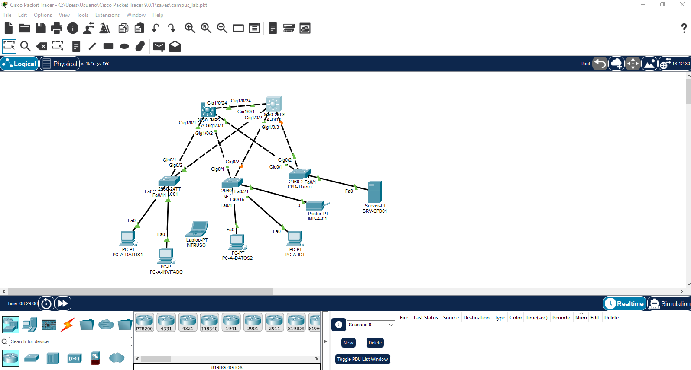
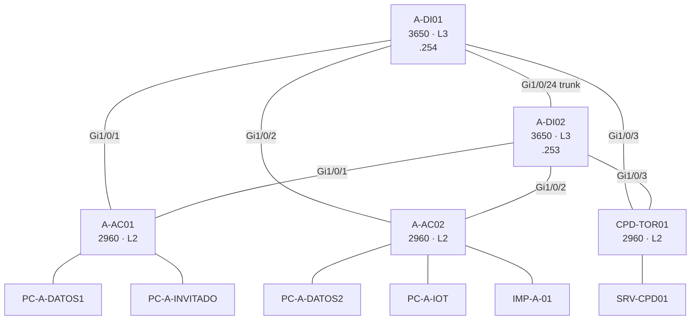
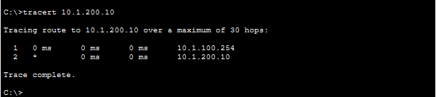
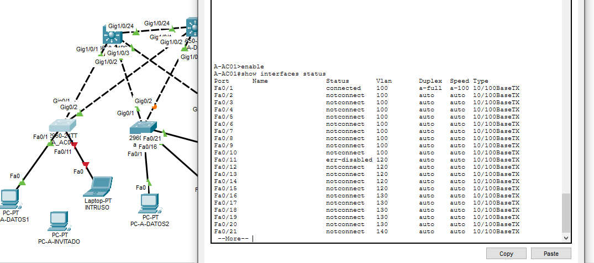

# Phase 1 — Switching Block (Building A)

**Status:** ✅ Done · **Tool:** Cisco Packet Tracer · **Devices:** 2 × Catalyst 3650-24PS (distribution), 3 × Catalyst 2960-24TT (access + data-center ToR)

This phase builds the first **Switching Block** of the campus: building A and the small data center (CPD). It includes VLAN segmentation, 802.1Q trunks, inter-VLAN routing at the distribution layer, a management VLAN and port security on every user port.

High availability (HSRP, tuned STP, EtherChannel) is **not** part of this phase on purpose. Phase 1 ends with a failover experiment that shows *why* phase 2 is needed.

---

## 1. Topology

Every access switch (and the ToR) has **two uplinks**: Gig0/1 to A-DI01 and Gig0/2 to A-DI02. The two distribution switches are joined by a trunk on Gi1/0/24. Switch-to-switch links use cross-over cables.

| Layer | Device | Role |
|---|---|---|
| Distribution | A-DI01, A-DI02 | Multilayer (L2/L3) switches. They hold the default gateways (SVIs) and route between VLANs (`ip routing`). |
| Access | A-AC01, A-AC02 | L2 switches where users, phones, IoT devices and printers connect. |
| Data center | CPD-TOR01 | Top-of-Rack L2 switch for the servers. |

> **Why these models?** The 3650 is a multilayer switch, so it can route between VLANs at the distribution layer without a router-on-a-stick. The 2960 is a typical access switch: L2 only, with FastEthernet user ports and two Gigabit uplinks. In Packet Tracer the 3650 needs the `AC-POWER-SUPPLY` module before it can be powered on.

## 2. VLAN and addressing plan

Addressing follows the rule **`10.<building>.<VLAN>.0/24`**: building A = `1`, and the third octet matches the VLAN ID. Any IP address tells you its building and VLAN at a glance. Building B will use `10.2.X.0/24` in phase 2.

| VLAN | Name | Subnet | Gateway (DI01 / DI02) | Purpose |
|---|---|---|---|---|
| 99 | GESTION | 10.1.99.0/24 | .254 / .253 | Switch management (SVIs .11, .12, .13) |
| 100 | DATOS | 10.1.100.0/24 | .254 / .253 | Employee PCs |
| 110 | VOZ | 10.1.110.0/24 | .254 / .253 | IP phones (voice VLAN) |
| 120 | INVITADOS | 10.1.120.0/24 | .254 / .253 | Guests |
| 130 | IOT | 10.1.130.0/24 | .254 / .253 | IoT devices |
| 140 | IMPRESORAS | 10.1.140.0/24 | .254 / .253 | Printers |
| 200 | SERVIDORES | 10.1.200.0/24 | .254 / .253 | Data-center servers |
| 999 | NATIVA | — (no SVI) | — | Native VLAN of every trunk, carries no user traffic |

**Hosts**

| Host | IP | VLAN | Switch / port |
|---|---|---|---|
| PC-A-DATOS1 | 10.1.100.10 | 100 | A-AC01 Fa0/1 |
| PC-A-DATOS2 | 10.1.100.11 | 100 | A-AC02 Fa0/1 |
| PC-A-INVITADO | 10.1.120.10 | 120 | A-AC01 Fa0/11 |
| PC-A-IOT | 10.1.130.10 | 130 | A-AC02 Fa0/16 |
| IMP-A-01 | 10.1.140.10 | 140 | A-AC02 Fa0/21 |
| SRV-CPD01 | 10.1.200.10 | 200 | CPD-TOR01 Fa0/1 |

All hosts use **`.254` (A-DI01)** as their gateway for now. In phase 2 it becomes an HSRP virtual IP (`.252`) shared by both distribution switches.

> **Why a /24 per VLAN?** One VLAN = one subnet = one broadcast domain. A /24 gives 254 usable hosts, far more than this lab needs. It keeps the plan readable and leaves room to grow. Address efficiency is not a goal in a private 10.0.0.0/8 network.

## 3. Access port layout (A-AC01 / A-AC02)

| Ports | Mode | VLAN | Port security |
|---|---|---|---|
| Fa0/1–10 | access | data 100 + voice 110 | sticky, max **2** MACs (PC + IP phone) |
| Fa0/11–15 | access | 120 guests | sticky, max 1 |
| Fa0/16–20 | access | 130 IoT | sticky, max 1 |
| Fa0/21–22 | access | 140 printers | sticky, max 1 |
| Fa0/23–24 | access | — | **shutdown** |
| Gig0/1–2 | trunk | native 999, allowed 99,100,110,120,130,140,999 | — |

CPD-TOR01: Fa0/1 is in VLAN 200 (sticky, max 1). Fa0/2–24 are access + shutdown. The uplinks only allow **99, 200, 999**.

Every port has a fixed purpose. A device plugged into a given port always lands in the same VLAN, so the wall socket decides the network.

## 4. Design decisions

Each decision below is a small hardening step. Together they are the baseline that phases 5 and 7 build on.

| Decision | Config | Why |
|---|---|---|
| **VTP transparent** | `vtp mode transparent` | Each switch manages its own VLAN database. This avoids the "VTP bomb": a switch with a higher revision number cannot wipe the VLANs of the whole domain. In transparent mode the VLANs are stored in the running-config, so they appear in the exported configs. |
| **Dedicated, unused native VLAN** | `switchport trunk native vlan 999` | Untagged frames on a trunk fall into the native VLAN. If the native VLAN were VLAN 1 or a user VLAN, an attacker could use **double tagging (VLAN hopping)** to inject frames into another VLAN. VLAN 999 has no SVI and no hosts. |
| **No DTP** | `switchport mode trunk` / `mode access` + `switchport nonegotiate` | Every port has a fixed role. A device cannot negotiate a trunk with the switch (switch spoofing). |
| **Allowed-VLAN lists** | `switchport trunk allowed vlan ...` | Each trunk carries only the VLANs that exist behind it. The access trunks do not carry the server VLAN 200. The ToR trunk carries only 99 and 200. |
| **Management VLAN** | `interface vlan 99` + `ip default-gateway 10.1.99.254` | Management is kept out of VLAN 1 and user VLANs. L2 switches need `ip default-gateway` to be reached from other subnets, because they do not route. |
| **Inter-VLAN routing at distribution** | `ip routing` + one SVI per VLAN | Routing happens in hardware on the 3650, close to the users. It removes the router-on-a-stick bottleneck. |
| **Unused ports shut down** | `switchport mode access` + `shutdown` | A port that is not cabled cannot be used. It stays in access mode, so it cannot become a trunk even if someone enables it. |
| **Port security** | `port-security`, `mac-address sticky`, `maximum 1/2`, violation `shutdown` (default) | Only the first learned device(s) may use each port. An unknown device shuts the port down (`err-disabled`). |
| **`no ip domain-lookup`** | — | A mistyped command is not treated as a hostname to resolve, so the CLI does not freeze. |

> **Note on the exported configs:** `switchport port-security maximum 1` and `violation shutdown` do not appear in the running-config. **IOS hides default values.** Only `maximum 2` is visible, on Fa0/1–10.

## 5. Verification

### 5.1 Commands

| Check | Command | Expected result |
|---|---|---|
| VLANs and port membership | `show vlan brief` | 8 VLANs, ports as in section 3 |
| Trunks | `show interfaces trunk` | Native 999, same allowed list on both ends |
| No disabled ports | `show interfaces status` | No `err-disabled` |
| Port security | `show port-security` / `show port-security address` | 0 violations, one sticky MAC per connected device |
| SVIs | `show ip interface brief \| include Vlan` | All SVIs up/up (`include` is case-sensitive: `Vlan`, not `vlan`) |
| Neighbours | `show cdp neighbors` | Each uplink connected to the expected port |
| STP | `show spanning-tree vlan 100` | One root bridge, redundant uplinks in `BLK` |

### 5.2 Connectivity tests (from PC-A-DATOS1)

| Test | Destination | Result |
|---|---|---|
| Same VLAN | PC-A-DATOS2 10.1.100.11 | ✅ |
| Inter-VLAN | SRV-CPD01 10.1.200.10 | ✅ `tracert` shows 1 hop (the gateway), TTL 128 → 127 |
| Inter-VLAN | IMP-A-01 10.1.140.10 | ✅ |
| Management | 10.1.99.11 / .12 / .13 | ✅ |

### 5.3 What happens inside a packet (simulation mode)

The ping from PC-A-DATOS1 to SRV-CPD01 was followed hop by hop in simulation mode:

1. PC-A-DATOS1 sees that 10.1.200.10 is outside its subnet, so it sends an **ARP** request for its *gateway* (.254), not for the server. The request is a broadcast and stays inside VLAN 100. The reply is unicast and only comes from the owner of the IP.
2. The ICMP frame goes to the gateway's MAC. At A-DI01 the frame is **rewritten**: new source MAC (the SVI of VLAN 200), new destination MAC (the server's). **TTL decrements by 1.**
3. The **IP addresses never change** along the path. MAC addresses change at every routed hop.

### 5.4 Port security test (intruder)

A second PC was plugged into an access port that had already learned a sticky MAC. The switch saw an unknown MAC and moved the port to **`err-disabled`**. The intruder had no connectivity. The port only came back after `shutdown` + `no shutdown` with the legitimate device reconnected.

### 5.5 Failover experiment — the reason for phase 2

A-DI01 was taken down (`interface range gi1/0/1 - 24` + `shutdown`):

| What | Result | Why |
|---|---|---|
| L2 traffic inside a VLAN (PC ↔ PC) | ✅ Recovered after ~30–50 s | STP unblocked the redundant uplinks to A-DI02. Classic 802.1D convergence is slow. |
| Traffic to other VLANs (PC → server) | ❌ Failed | The hosts' only gateway (.254) lived on A-DI01. A-DI02 has `.253`, but nobody uses it. |
| STP root bridge | Moved to **A-AC01** | With default priorities (32768 + VLAN ID) the root is the switch with the **lowest MAC**. A-DI01 was root by chance. Without it, an *access* switch became root, which is a bad design. |

**Conclusion:** the network has redundant *links*, but not a redundant *gateway*, and STP is left to chance. Phase 2 fixes this with HSRP (virtual gateway with preempt), deterministic root placement (`root primary/secondary`), faster STP and EtherChannel.

## 6. Troubleshooting log (lessons learned)

| Problem | Cause | Fix / lesson |
|---|---|---|
| CDP showed a *native VLAN mismatch* on CPD-TOR01 | ToR uplinks still had native VLAN 1, distribution had 999 | Both ends of a trunk must agree on native VLAN and allowed list. |
| `show ip interface brief \| include vlan` returned nothing | `include` is **case-sensitive** | Use `Vlan`. |
| Ping to the management IP of A-AC01 failed | SVI 99 and `ip default-gateway` were never configured | Verify *every* device, not just one. |
| Pings failed intermittently even though the config was correct | Packet Tracer simulation state | *Power Cycle Devices* + *Fast Forward Time* before testing. |
| Port security disappeared after a power cycle | Config was only in the running-config (RAM) | `copy running-config startup-config` after every change. The startup-config lives in NVRAM. |
| Sticky learned the wrong MAC | Sticky stores the **first** MAC it sees | Enable port security with the legitimate device connected. |
| `maximum 1` rejected | Incomplete command | The full command is `switchport port-security maximum 1`; `?` lists the valid options. |
| Unused ToR ports configured as trunks | A range command was applied while still inside `interface range fa0/2 - 24` | Even shut down, a trunk port is a risk: one `no shutdown` would give a rogue device access to VLANs 99 and 200. Fixed to access + shutdown. |
| *Destination host unreachable* vs *Request timed out* | Typo in the IP (10.100.100.11) | *Unreachable* = a device answered that it has no route. *Timeout* = no answer at all. |
| Some errors only showed up after a failure | Redundancy hid them (traffic used the other path) | Test each path on its own. |

## 7. Known limitations (to be fixed in later phases)

This phase is a functional, hardened baseline, **not** a secure network yet. Known weaknesses:

| # | Weakness | Fixed in |
|---|---|---|
| 1 | Single gateway (.254) and slow STP convergence, with the root left to chance | Phase 2 — HSRP, root primary/secondary, RSTP, EtherChannel |
| 2 | **All VLANs can reach each other**: guests and IoT reach the servers | Phase 5 — inter-VLAN ACLs |
| 3 | No passwords: `enable secret`, console, local users | Phase 5 |
| 4 | Management reachable from any VLAN; no SSH and no authentication on the VTY lines | Phase 5 — management ACL + SSH |
| 5 | CDP advertises device details on user ports | Phase 5 — `no cdp enable` on access ports |
| 6 | Port security is bypassed by **MAC spoofing** | Phase 7 demo; real fix is 802.1X / NAC |
| 7 | No protection against a rogue switch, STP root attack or loops | Phases 5/7 — BPDU Guard, Root Guard |
| 8 | No DHCP snooping or Dynamic ARP Inspection | Phases 5/7 |
| 9 | No logging or alerting | Phase 6 — Syslog |

## 8. Files

| File | Content |
|---|---|
| [`configs/A-DI01.txt`](configs/A-DI01.txt) | Distribution switch 1 |
| [`configs/A-DI02.txt`](configs/A-DI02.txt) | Distribution switch 2 |
| [`configs/A-AC01.txt`](configs/A-AC01.txt) | Access switch 1 |
| [`configs/A-AC02.txt`](configs/A-AC02.txt) | Access switch 2 |
| [`configs/CPD-TOR01.txt`](configs/CPD-TOR01.txt) | Data-center ToR switch |
| `campuslab-phase1.pkt` | Packet Tracer file |

## 9. Concepts reviewed in this phase

Hierarchical model (access / distribution / core) · Switching Block · VLAN = subnet = broadcast domain · 802.1Q tagging and native VLAN · DTP and VTP · SVIs and inter-VLAN routing · ARP · MAC vs IP along a routed path · TTL · subnetting (/24, /25, /27) · STP root election, port roles and states · port security and `err-disabled` · running-config vs startup-config.
